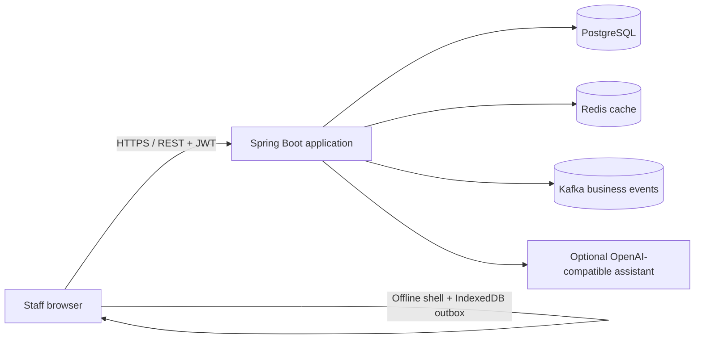

# Stockwise ERP

Stockwise is an end-to-end operations ERP for a fictional regional wholesale distributor. It connects order entry, purchasing, inventory, invoicing, reporting, and replenishment in one workflow.

## Try it without installing anything

Open `backend/src/main/resources/static/index.html` in Chrome, Edge, or Safari. You can double-click the file in Finder, or open it from the browser. The browser-only demo starts automatically; no Docker, Java, database, or account setup is needed.

Use the left navigation to explore Overview, Sales orders, Inventory, Purchasing, Customers, Suppliers, Invoices, Reports, and the Assistant. Try **New order**, **Count**, **New purchase order**, **Receive**, and **Record payment** to see how the workflows affect stock and invoices.

Changes are saved in that browser on that device. This mode is a single-user demonstration and does not sync with another computer. The Assistant uses local replenishment rules; connecting a real AI assistant requires running the backend and configuring an API key. To start fresh, clear this file's browser storage/site data.

If you later install Docker, use the server-backed run steps below for the full database and API setup.

## Client brief

**Client:** Northstar Supply Co., a regional distributor with a small sales and operations team, starting with one warehouse.

**Problem:** Orders, supplier receipts, and stock counts are maintained in separate tools. Teams need one reliable view of available stock and order status, including when the warehouse temporarily loses connectivity.

**Release goal:** Give sales, procurement, warehouse, and finance staff a shared operational system with an auditable stock ledger and an offline-tolerant browser workflow.

## Prototype scope and server starter

The no-install browser demo simulates the workflows with data stored in that browser. The Java backend and infrastructure files are a full-stack starter implementation, but the complete server stack was not run and verified end to end in this environment. Treat the Redis, Kafka, database, authentication, and optional AI integrations as source code to inspect and continue building—not as a live client deployment.

- Sales orders validate and reserve available stock, write stock movements, and create an invoice atomically.
- Purchase orders track expected quantities. Receiving goods increases stock and writes the corresponding ledger entries.
- Product, customer, supplier, invoice, and payment workflows with search and basic validation.
- Dashboard, sales reporting, low-stock alerts, and data-backed reorder suggestions.
- JWT sign-in with roles (`ADMIN`, `SALES`, `WAREHOUSE`, `PROCUREMENT`, `FINANCE`).
- PostgreSQL persistence, Redis dashboard caching, a transactional outbox with at-least-once Kafka delivery, and an audit log.
- Browser app shell and cached GET responses for offline access. Queued stock adjustments and sales orders sync with idempotency keys when connectivity returns.
- Demo dataset for Northstar Supply Co.

## Architecture

The first release uses a modular Spring Boot application so a small client team can operate it without coordinating a fleet of services. Domain boundaries are separated in code. Transactional outbox records are written with business changes and retried to Kafka after commit; consumers should deduplicate by `eventId` because delivery is at least once.

## Run locally

Requirements: Docker with Compose, or Java 21, Maven 3.9+, PostgreSQL 16, Redis 7, and Kafka 3.9.

1. Copy `.env.example` to `.env` and set a long random `JWT_SECRET` (at least 32 characters).
2. Start the platform: `docker compose up --build`.
3. Open <http://localhost:8080>.
4. Sign in with `admin@northstar.test` / `ChangeMe!2026`.

The demo account is for local evaluation only. Change the seed password and JWT secret before sharing any deployment. Docker Compose exposes Postgres, Redis, and Kafka only on the internal network; the application is exposed on port 8080.

For local Java development, start the dependencies with `docker compose up postgres redis kafka`, then run `cd backend && mvn spring-boot:run`. The UI is served by Spring Boot from the same origin.

## Configuration

| Variable | Default | Purpose |
| --- | --- | --- |
| `DB_URL` | `jdbc:postgresql://localhost:5432/stockwise` | PostgreSQL JDBC URL |
| `DB_USERNAME` | `stockwise` | Database user |
| `DB_PASSWORD` | `stockwise` | Database password |
| `REDIS_HOST` | `localhost` | Redis hostname |
| `KAFKA_BOOTSTRAP_SERVERS` | `localhost:9092` | Kafka bootstrap servers |
| `JWT_SECRET` | local development value | HMAC signing key; override outside local development |
| `JWT_TTL_MINUTES` | `480` | Access token lifetime |
| `OPENAI_API_KEY` | unset | Optional key for the assistant endpoint |
| `OPENAI_MODEL` | `gpt-4.1-mini` | Model used by optional assistant endpoint |

## Main API routes

All `/api/**` routes require `Authorization: Bearer <token>` except `POST /api/auth/login` and `GET /api/health`.

| Area | Routes |
| --- | --- |
| Session | `POST /api/auth/login`, `GET /api/auth/me` |
| Dashboard | `GET /api/dashboard`, `GET /api/reports/sales` |
| Catalog | `GET/POST /api/products`, `POST /api/stock/adjustments` |
| Parties | `GET/POST /api/customers`, `GET/POST /api/suppliers` |
| Sales | `GET/POST /api/orders` |
| Purchasing | `GET/POST /api/purchase-orders`, `GET /api/purchase-orders/{id}`, `POST /api/purchase-orders/{id}/receive` |
| Finance | `GET /api/invoices`, `POST /api/invoices/{id}/payments` |
| Automation | `GET /api/ai/reorder-suggestions`, `POST /api/ai/assistant` |
| Offline sync | `POST /api/sync/push` |

## Roles and operating rules

- **ADMIN:** all implemented workflows.
- **SALES:** customers, sales orders, and invoice visibility.
- **WAREHOUSE:** product visibility, stock counts, and receiving.
- **PROCUREMENT:** suppliers and purchase orders.
- **FINANCE:** invoices and payments.

The UI presents the complete workspace to the signed-in user; the backend is the source of truth for authorization. Stock is not allowed to drop below zero through sales orders. A stock adjustment records a reason and actor. Offline retries use operation IDs to prevent a repeated order or adjustment from being applied twice.

## Data and operations

Flyway creates the schema and indexes on startup. Seed records are inserted once on a new database. `inventory_movements` is the stock audit trail; `audit_log` records business actions. Kafka topics are created by the application on startup. Redis stores short-lived dashboard data and mutations evict that cache.

## Delivery boundary

This is a client-style portfolio prototype and full-stack starter, not an accepted client delivery or production release. Before a real rollout, the client would provide its legal entity and warehouse structure, tax and invoice rules, payment provider, identity provider, backup/retention policy, and deployment target. The complete backend needs to be built, run, security-reviewed, and validated against those requirements. Multi-warehouse allocation, general ledger accounting, tax jurisdiction rules, and third-party payment capture are outside this prototype's scope.

## Technical stack

- Java 21, Spring Boot 3.5, Spring Security, JDBC, Flyway
- PostgreSQL 16, Redis 7, Apache Kafka
- HTML, CSS, JavaScript, IndexedDB, Service Worker
- Docker Compose
